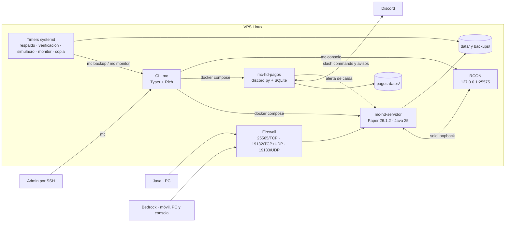

# Minecraft HD

[](https://github.com/BrianMariscal/Minecraft-Server/actions/workflows/ci.yml)
[](https://github.com/BrianMariscal/Minecraft-Server/actions/workflows/ci.yml)
[](https://github.com/BrianMariscal/Minecraft-Server/actions/workflows/ci.yml)
[](https://www.python.org/)
[](https://docs.docker.com/compose/)
[](LICENSE)

Servidor de Minecraft para un grupo de 15 personas. Las cuentas no son premium, Java y Bedrock comparten el mismo mundo y todo está en español de México. Corre en un VPS con Docker y se administra con `mc`, una CLI que hice en Python.

Este repositorio es la copia pública. No trae el mundo, los nombres reales, los IDs de Discord ni los secretos. Eso se queda en el VPS y en un repositorio privado.

## Para jugar

Hay whitelist y registro con contraseña porque las cuentas no son premium. Los jugadores tienen `/home`, `/sethome`, `/spawn`, `/tpa` y `/back`; al morir dejan una tumba con sus cosas y su XP durante una hora. Los datapacks de Terralith, Incendium, Nullscape, Dungeons and Taverns y Towns and Towers son de bloques vanilla para que Bedrock los vea igual que Java.

Las instrucciones para entrar están en [docs/conectarse.md](docs/conectarse.md).

## Cómo está armado

Hay dos contenedores y cinco timers: cuatro del sistema y uno de usuario. `mc-hd-servidor` corre Paper 26.1.2 con Java 25 y `mc-hd-pagos` es el bot de Discord que lleva el cobro del VPS. Los respaldos corren con systemd y `mc backup now`, así que siguen funcionando aunque Minecraft esté apagado.



El bot de pagos solo arranca si `pagos.activo` está encendido en `settings.yml`. RCON escucha en `127.0.0.1:25575`, dentro del VPS.

## Decisiones que conviene conocer

- **Versiones fijas.** Los 28 artefactos descargables (18 plugins, 5 datapacks y 5 packs de Vanilla Tweaks) tienen versión y SHA256 en `minecraft/manifest.yml`. Si un hash no coincide, `mc build` se detiene. El ZIP de Vanilla Tweaks es la excepción: cambia de bytes entre generaciones, así que se verifican los 5 packs de adentro.
- **Configuración validada.** `settings.yml` y `.env` pasan por pydantic. Las configs de los plugins se generan con Jinja2 y no se editan en `data/`.
- **Versión fijada.** Paper 26.1.2 y Java 25, porque EssentialsX todavía no tiene release estable para 26.3. Está explicado en [docs/decisiones.md](docs/decisiones.md).
- **Monitoreo.** `mc doctor` revisa puertos, RAM, disco, TPS, versiones y traducciones. `mc-monitor.timer` corre cada hora y avisa por Discord si algo se ve mal.

## Stack

Python 3.12+, Docker Compose, Paper 26.1.2, Java 25, Typer + Rich, pydantic, Jinja2, uv, RCON y pytest.

## Cómo se usa

```bash
mc setup    # crea settings.yml desde el ejemplo y pide los secretos
mc build    # baja los plugins con SHA256 y genera las configuraciones
mc start    # levanta los contenedores
mc doctor   # revisa puertos, RAM, disco, TPS y versiones
mc status   # muestra quién está conectado
```

La guía para montarlo desde cero está en [docs/vps.md](docs/vps.md). El servidor real no tiene URL pública: se entra por invitación y la dirección se comparte aparte.

## Salida de `mc doctor`

Así se ve en el VPS de producción:

```text
Revisando Minecraft HD
✓ Docker: funcionando (5.6.0)
✓ Memoria: 7.7 GB disponibles, el servidor pide 4G
✓ Disco: 173.8 GB libres
✓ Puerto 25565 (Java): lo usa el servidor, que está encendido
✓ Puerto 19132 (Bedrock): lo usa el servidor, que está encendido
✓ Puerto 19133 (Bedrock WebRTC): lo usa el servidor, que está encendido
✓ Versiones: Minecraft 26.1.2, todo cuadra
✓ Secretos (.env): todo lo necesario está lleno
✓ Logo: logo/logo.png listo, se convierte a 64x64 al arrancar
✓ Docker Compose: versión, memoria y puertos al día con settings.yml
✓ Traducciones: no encontré mensajes en inglés
✓ TPS: 20.0 de 20

Resumen
  Todo en orden.
```

## Seguridad

La whitelist está encendida y AuthMe pide `/register` y `/login`, porque con cuentas no premium el nombre no prueba nada. RCON solo escucha en loopback. CoreProtect guarda quién movió cada bloque y permite revertir cambios.

Los tokens viven en `.env` y los datos de los jugadores en `settings.yml`. Ninguno de los dos entra a git. El CI corre `gitleaks` sobre todo el historial.

## Pruebas

Hay 601 tests y ninguno necesita Docker. Se corren con `uv run pytest`; la cobertura, con `uv run pytest --cov=mc_admin --cov=pagos_bot`. `pyproject.toml` fija `fail_under = 67`, así que un cambio que baje la cobertura hace fallar el test.

También hay un smoke semanal en GitHub Actions que baja los 28 artefactos reales y corre `mc build` dos veces para comprobar que sea idempotente.

## Límites

- Es para un servidor y un grupo. No está hecho para varios servidores o clientes.
- El bot de pagos maneja una moneda (MXN), un guild y un canal. No es un sistema de cobros genérico.
- El libro de recetas de Bedrock es independiente del de Java. Desbloquear el Fabricador en Java no lo desbloquea en Bedrock; ahí hay que obtener un dropper para que aparezca.
- La versión está fijada. Subirla implica probar plugins y regenerar configs.
- La cobertura es 68%, no 100%: los módulos que hablan con Discord o Docker se prueban con dobles y algunas ramas de arranque quedan fuera.
- No hay URL pública. Se entra por invitación.

## Licencia

[MIT](LICENSE). El código se puede reutilizar. Los datos reales (nombres, IDs, mundos y secretos) no están en el repositorio.

## Documentación

| Documento | Contenido |
|---|---|
| **[docs/vps.md](docs/vps.md)** | Montar el VPS desde cero: Docker, `uv`, firewall, dominio y mudanza de proveedor |
| **[docs/comandos.md](docs/comandos.md)** | Todos los comandos de `mc` y qué hace cada uno |
| **[docs/administrar.md](docs/administrar.md)** | Whitelist, admins, pregen, regenerar el mundo y CoreProtect |
| **[docs/conectarse.md](docs/conectarse.md)** | Cómo entrar desde Java, Bedrock y consolas |
| **[docs/vincular-cuentas.md](docs/vincular-cuentas.md)** | Tener el mismo personaje en Java y en Bedrock |
| **[docs/respaldos.md](docs/respaldos.md)** | Respaldos automáticos, verificación, simulacro de restauración, copia a la PC y alertas |
| **[docs/bot-pagos.md](docs/bot-pagos.md)** | Crear el bot de Discord y configurar los cobros del VPS |
| **[docs/versiones.md](docs/versiones.md)** | Qué versión está fijada, por qué y cómo subirla |
| **[docs/decisiones.md](docs/decisiones.md)** | Las decisiones de diseño que conviene conocer |
| **[docs/dev.md](docs/dev.md)** | Desarrollo, tests, CI y estructura del repositorio |
