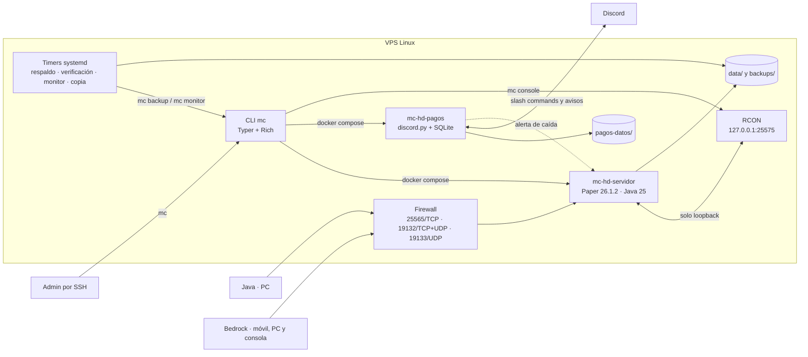

# Minecraft HD

> Servidor de Minecraft multiplataforma en producción: Java y Bedrock en el mismo mundo, Docker, CLI con **575 tests**, version pinning con **SHA256** y bot de pagos automatizado.

[](https://github.com/BrianMariscal/Minecraft-Server/actions/workflows/ci.yml)
[](https://www.python.org/)
[](https://docs.docker.com/compose/)

Servidor para jugar con la banda: cuentas no premium, hasta 15 jugadores y todo en español de México. Corre en un VPS Linux y se administra con `mc`, una CLI hecha en Python.

---

## Arquitectura

Dos contenedores y cuatro timers (tres del sistema y uno de usuario). Los respaldos **no** son un contenedor: los ejecuta systemd con `mc backup now`, para que sigan funcionando aunque el servidor de Minecraft esté apagado.



`mc-hd-pagos` es opcional: solo arranca cuando `pagos.activo` está encendido en `settings.yml`. El servidor de Minecraft queda en `mc-hd-servidor` y RCON escucha únicamente en loopback.

## Decisiones clave

- **Supply chain verificable:** los **28 artefactos** descargables (17 plugins, la base SQLite de Floodgate, 5 datapacks y 5 packs de Vanilla Tweaks) están fijados con versión y **SHA256**. `mc build` falla si un hash no coincide; nunca instala `latest`.
- **575 tests que no dependen de Docker:** ningún test levanta un contenedor ni abre un socket. Docker y RCON se sustituyen por dobles, y los tests leen `settings.yml`, `manifest.yml` y las plantillas reales.
- **Tipos y validación en serio:** `mypy` en modo estricto, `ruff` para lint y formato, y `pydantic` para validar `settings.yml` y `.env`. Las configs se generan con **Jinja2**, no se editan a mano en `data/`.
- **Versiones fijadas con intención:** Paper **26.1.2** y Java 25, no la versión más nueva: EssentialsX todavía no tiene release estable para 26.3. El detalle está en [docs/decisiones.md](docs/decisiones.md).
- **Salud observable:** `mc doctor` revisa puertos, RAM, disco, TPS, versiones y traducciones; `mc-monitor.timer` vigila respaldo, disco y servidor cada hora y avisa por Discord.

## Stack

Python 3.12+ · Docker Compose · Paper 26.1.2 · Java 25 · Typer + Rich · pydantic · Jinja2 · uv · RCON · pytest

## Uso rápido

```bash
mc setup    # revisa el entorno, crea .env y pide los secretos
mc build    # descarga con SHA256 y genera las configuraciones
mc start    # levanta los contenedores
mc doctor   # revisa puertos, RAM, disco, TPS y versiones
mc status   # ve quién está conectado
```

La guía completa para montarlo desde cero está en **[docs/vps.md](docs/vps.md)**.

## Seguridad

- **SHA256 en cada descarga:** plugins, datapacks y packs de Vanilla Tweaks se verifican antes de instalarse; un hash distinto aborta el build.
- **Acceso controlado:** whitelist encendida, `/register` y `/login` para cuentas no premium, y RCON expuesto solo en `127.0.0.1:25575`.
- **Auditoría y rollback:** CoreProtect registra quién movió cada bloque y permite revertir cambios.
- **Secretos fuera de git:** tokens y contraseñas viven en `.env`; el repositorio solo incluye `.env.example` y el CI corre `gitleaks`.

## Testing

**575 tests. Ninguno levanta un contenedor ni abre un socket:** Docker y RCON se sustituyen por dobles, y los tests usan el `settings.yml`, el `manifest.yml` y las plantillas reales.

Se corren con `uv run pytest`; la cobertura, con `uv run pytest --cov=mc_admin --cov=pagos_bot`.

## Documentación

| Documento | Contenido |
|---|---|
| **[docs/vps.md](docs/vps.md)** | Montar el VPS desde cero: Docker, `uv`, firewall, dominio y mudanza de proveedor |
| **[docs/comandos.md](docs/comandos.md)** | Todos los comandos de `mc`, con qué hace cada uno |
| **[docs/administrar.md](docs/administrar.md)** | Whitelist, admins, pregen, regenerar el mundo y CoreProtect |
| **[docs/conectarse.md](docs/conectarse.md)** | Cómo entra la banda desde Java, Bedrock y consolas |
| **[docs/vincular-cuentas.md](docs/vincular-cuentas.md)** | Tener el mismo personaje en Java y en Bedrock |
| **[docs/respaldos.md](docs/respaldos.md)** | Respaldos automáticos, verificación, copia a la PC, alertas y restore |
| **[docs/bot-pagos.md](docs/bot-pagos.md)** | Crear el bot de Discord y configurar los cobros del VPS |
| **[docs/versiones.md](docs/versiones.md)** | Qué versión está fijada, por qué y cómo subirla |
| **[docs/decisiones.md](docs/decisiones.md)** | Las decisiones de diseño que conviene conocer |
| **[docs/dev.md](docs/dev.md)** | Desarrollo, tests, CI y estructura del repositorio |
